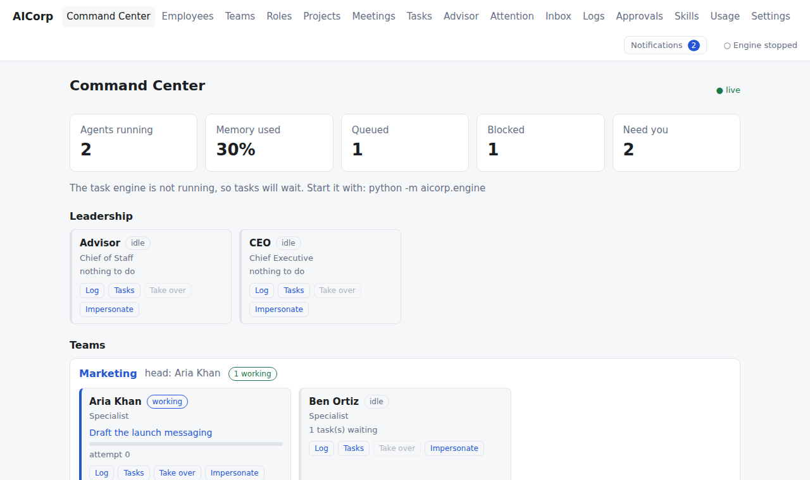
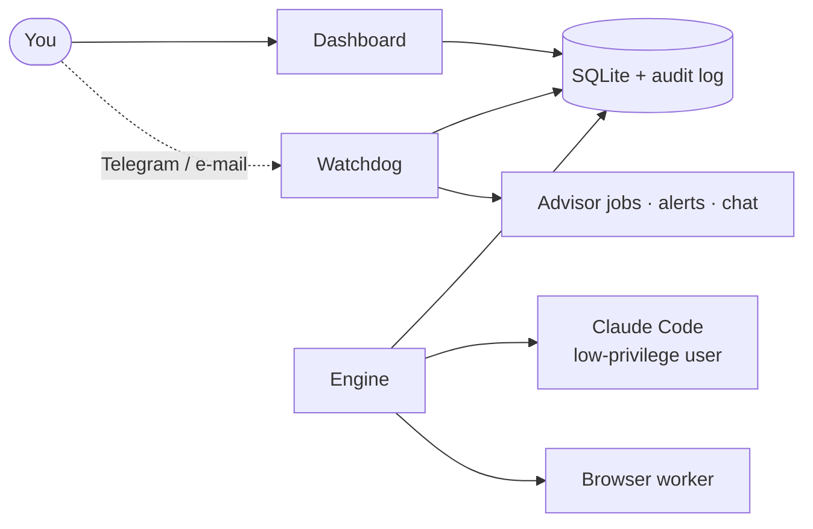

# AICorp

**A local-first office for one person.** Create employees, teams and roles, hand them tasks, watch the work live, approve what
leaves the company, and keep a tamper-evident log of everything — all on your own computer.

> **There is no AI inside AICorp and no API key.** When a task needs AI, AICorp runs [Claude Code](https://www.anthropic.com/claude-code)
> under *your own* Claude subscription (or drives a browser you already use). Cost of AICorp itself: nothing.

*Terminology:* the **Founder** is you, the owner and only human user of your company.



## What you get

| | |
|---|---|
| **Org chart as data** | employees (permanent or temporary, unique names), roles, teams, skills, per-person model and limits |
| **Live Command Center** | who is working, blocked or idle, updating in real time |
| **Task engine** | dependencies, parallel runs with a memory guard, leases and crash recovery, retries, usage-limit pause and auto-resume, kill switch |
| **Guardrails** | risk tiers, a fail-closed hook on every tool call, a separate low-privilege OS user, protected paths, input guard, secret scrubbing |
| **Approvals** | anything that would leave the company (send, publish, push) is prepared as a draft and waits for you |
| **Advisor (chief of staff)** | reminds you, nags with an escalation ladder, keeps one desk for projects, meetings and approvals, writes briefings; read-only by design |
| **Telegram and e-mail** | alerts, and a two-way chat with the Advisor (`/status`, `/pending`, free questions) |
| **Impersonate and take over** | act as an employee (both identities logged) or stop an agent and work in its task yourself |
| **Browser worker** | Playwright with its own profile; hands CAPTCHAs and logins to you, never bypasses them |
| **Audit log** | every action, hash-chained and searchable; backups restore to another machine |

## How it fits together



Three small programs share one SQLite database: the **dashboard** (what you click), the **engine** (runs tasks) and the **watchdog**
(alerts, the Advisor's schedule, chat). Everything binds to `127.0.0.1`.

## Requirements

* Python 3.12 or newer
* Linux or Windows + WSL2 (see [Platform status](#platform-status))
* For real work: Claude Code, logged in with your own Claude subscription, as a separate low-privilege user ([setup](docs/SETUP-LINUX.md))
* Optional: a Telegram bot and a Gmail app password for alerts/chat; Chromium (via Playwright) for the browser worker

## Quick start

```bash
git clone https://github.com/mdirfanali-dev/ai-corp.git
cd ai-corp
python3 -m venv .venv && . .venv/bin/activate
pip install -e .

export AICORP_HOME="$HOME/aicorp-data"        # any empty folder: your company's data lives here
python -m aicorp.web                           # open http://127.0.0.1:8765
```

Not sure your computer is ready? Run `python -m aicorp.doctor` ([what it checks](docs/DOCTOR.md)).

Try it without using any AI (simulated work), in a second terminal:

```bash
export AICORP_HOME="$HOME/aicorp-data"
python -m aicorp.engine --runner fake
```

Create two employees, give one a task, and watch the Command Center. For real work, alerts and the browser worker follow the
[setup guide](docs/SETUP-LINUX.md) and the [user guide](docs/USER-GUIDE.md).

## Platform status

| Platform | Status | Notes |
|---|---|---|
| Windows + WSL2 | tested | Ubuntu under WSL2 is where AICorp is developed and tested |
| Linux | untested | same userland as the WSL2 setup, so expected to work; a native install has not been tried |
| macOS | untested | needs an equivalent low-privilege user set up by hand ([notes](docs/SETUP-MACOS.md)) |
| Windows (native) | unsupported | the engine and tests rely on POSIX processes and signals |

"Tested" means the automated test suite and the manual checks in this repository were run there. Please report what you find on
other platforms.

## Safety and disclaimers

* AICorp is an early release (0.1). Read the [security model](docs/SECURITY-MODEL.md) before letting agents run on a machine that
  holds data you cannot lose, and keep backups.
* **You need your own Claude subscription** to use the Claude runner and you are responsible for following Anthropic's terms.
  AICorp is an independent project and is not affiliated with or endorsed by Anthropic, Telegram, Google or any other provider named here.
* The browser worker automates websites you point it at. Many sites restrict automation; check each site's terms yourself
  (see `company/policies/browser-sites.md`). It never solves CAPTCHAs or logs in for you.
* Everything is provided "as is" under the Apache-2.0 license, without warranty.

## Documentation

* [User guide](docs/USER-GUIDE.md) · [Setup: Linux / WSL2](docs/SETUP-LINUX.md) · [macOS notes](docs/SETUP-MACOS.md)
* [Configuration](docs/CONFIGURATION.md) · [Security model](docs/SECURITY-MODEL.md) · [Troubleshooting](docs/TROUBLESHOOTING.md)
* [Third-party software](docs/THIRD_PARTY.md)

## Contributing and support

Pull requests are welcome, see [CONTRIBUTING.md](CONTRIBUTING.md) (fork, branch, pull request, DCO sign-off). Support is best effort.
Please report vulnerabilities privately, see [SECURITY.md](SECURITY.md). Everyone taking part is expected to follow the
[Code of Conduct](CODE_OF_CONDUCT.md).

## License

[Apache License 2.0](LICENSE), with a [NOTICE](NOTICE). The license covers the code; it does not grant rights to the names "AICorp" or
"AI Corporation".
