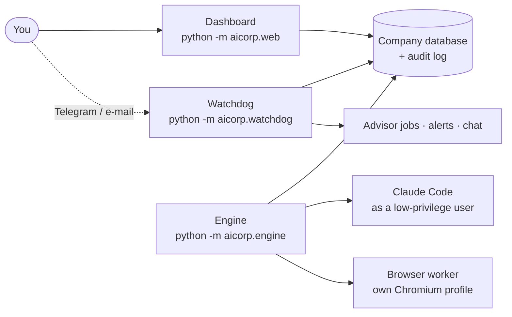
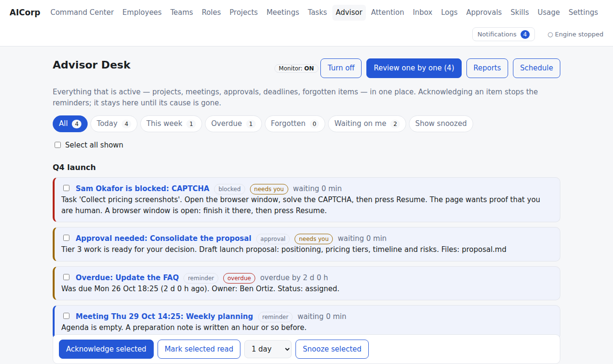
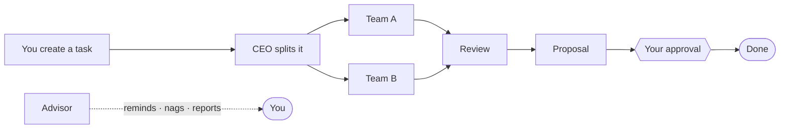
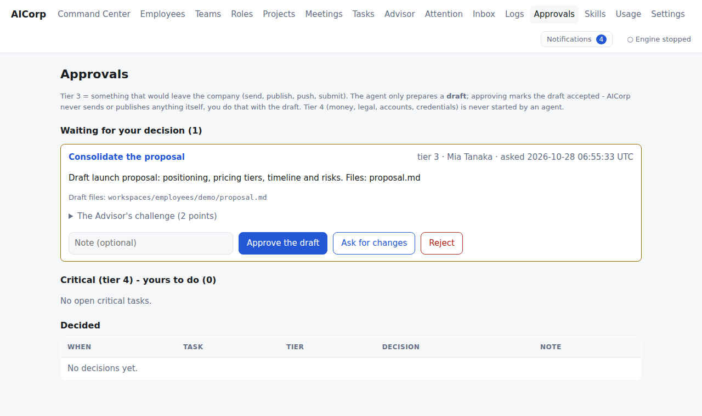

# AICorp user guide

AICorp is a **local-only office for one person**: a dashboard plus a small engine on your own computer. Employees, teams,
tasks, logs and memory are records and files on your disk. **There is no AI inside the app and no API key.** When work needs
AI, the engine runs *Claude Code under your own login* (or drives a browser you already use). Everything is logged.



## Start it with the control panel (one command)

```bash
python -m aicorp.app                 # simulated work; add --mode claude for real Claude Code
```

It starts the dashboard, the watchdog and the engine for you, picks a free port if 8765 is busy, and opens a control page
(default `http://127.0.0.1:8760/`) with:

* **System check**: the [doctor](DOCTOR.md) results, a *Recheck* button, one-click fixes where safe, and a help prompt you can paste into ChatGPT or Claude.
* **Live log panes** for the three programs. Choose one pane, side by side, stacked or a grid, and which programs to show; this only changes what you see, never what runs.
* **Control / Dashboard / Split**: the dashboard can be shown inside the same page, next to the logs.
* **Start / Stop**, **Restart** per program, and **Exit**, which stops the engine, the watchdog and the dashboard in order, closes browser windows AICorp opened, shows each step going off, and then ends the program. Ctrl+C in the terminal does the same.

If you already started the programs by hand on the same data folder, the control panel refuses to start a second copy and says so.
Alert links use the "dashboard address" from Settings; if the control panel had to choose another port, update it there.

## Start it by hand (three terminals)


| Program | Command | What it does |
|---|---|---|
| Dashboard | `python -m aicorp.web` → http://127.0.0.1:8765 | everything you click |
| Engine | `python -m aicorp.engine --runner claude` (`--runner fake` to try it without using Claude) | runs the tasks |
| Watchdog | `python -m aicorp.watchdog` | alerts you, runs the Advisor's schedule, listens to Telegram/e-mail, notices a dead engine |

Nothing runs while the computer is off or asleep; when it wakes, the Advisor catches up and writes a "while you were away" report.

## The pages


| Page | Use it to |
|---|---|
| **Command Center** | see who is working, blocked or idle — live. Each card has *Take over* and *Impersonate* |
| **Employees / Teams / Roles** | create people (permanent or temporary), give them roles, skills, tools, model and limits |
| **Tasks** | create work, set the risk tier, watch progress, cancel or retry |
| **Attention / Inbox** | everything that needs you (CAPTCHA, usage limit, failures, approvals) with what to do next |
| **Advisor** | your chief of staff: one desk for all projects, meetings, approvals and forgotten items; reports; schedule |
| **Approvals** | decide drafts that would leave the company (tier 3); tier 4 is yours to do |
| **Projects / Meetings** | goals, minutes, decisions, action items that become tasks |
| **Skills** | know-how files agents receive only when a task needs them; outside skills must be vetted |
| **Usage** | runs and tokens per employee, team and model; run limits |
| **Logs** | search the full audit trail by text, person, task, mode |
| **Settings / Maintenance** | alert channels, chat, browser worker; health check, trash |



## How work flows



Risk tiers: **0** read only · **1** draft in the employee's own folder · **2** run local, sandboxed commands · **3** anything that
leaves the company (send, publish, push) — the agent only prepares a *draft*, **you** approve and send it · **4** money, legal,
accounts, credentials — never started by an agent.



## Talking to the Advisor from your phone

Enter the Telegram bot and Gmail details in the dashboard under **Settings** (never in chat); they are saved privately in `config/secrets.env`. Then message your bot:
`/status` `/today` `/pending` `/blocked` `/projects` `/meetings` `/ack <id>` `/snooze <id> 2h` `/report` `/monitor on|off` `/stop`.
Anything else is a question answered by the Advisor while the engine runs. By e-mail put `[AICorp]` in the subject. Approvals,
permissions, secrets, deletes and releasing the kill switch are **dashboard only**.

## Acting as someone / taking over

* **Impersonate** (card or `/impersonate`): you act under an employee's name and role; the log shows
  `Founder ▶ acting as <name>`. That person's permissions apply unless you type OVERRIDE (then the banner is red).
* **Take over** (card or task page): stops the agent, saves where it was, lets you add notes and files, then *resume*, *finish it
  yourself* or *cancel*.

## Safety in one table

| Protection | How |
|---|---|
| Kill switch | the red button, or `touch STOP` in the data folder |
| Agents are boxed in | risk-tier tool list + a fail-closed hook + a separate OS user + audit of every tool call |
| Secrets | only in `config/secrets.env` (mode 600); scrubbed from logs, pages, backups |
| Nothing is hard-deleted | files go to `.trash` for 30 days; the audit log is append-only and hash-chained |
| Web text is data | pages, messages and other workers' output are never treated as instructions |

## Backups and moving to another computer

`python -m aicorp.cli backup` (also nightly at 02:30, the last 7 are kept) writes a `.tar.gz` of the database, company files, skills,
memory, artifacts and workspaces. **Secrets, browser profiles and the virtual environment are never included.**

To restore on another machine:
1. Install AICorp and its requirements there.
2. `python -m aicorp.cli restore <archive> <new-empty-folder>` (checks every checksum and the audit chain).
3. Point `AICORP_HOME` at the new folder, copy `config/secrets.env.example` to `config/secrets.env` and fill in your values.
4. Log in to Claude Code again and, for browser tasks, to any sites you use (the browser profile is per computer).

## When something looks wrong

| Symptom | Look at |
|---|---|
| Red "Engine stopped" | start the engine; unfinished tasks are recovered automatically |
| No Telegram/e-mail alerts | the watchdog must be running; Settings shows channel status |
| A task is "blocked" | Attention page says why and what to do (CAPTCHA/login → a window is open for you → press Resume) |
| Doubt about the logs | Maintenance → *Run maintenance now* (database integrity + full audit-chain check) |
| Full disk | the engine pauses new work and alerts you; free space, then it continues |

## Honest limits

Local only (no remote access); one person; Linux/WSL2 tested (Windows-native and macOS not yet); CAPTCHA and login handling is a
hand-off to you, never a bypass; the Advisor's checks are rules, not understanding; token savings only affect the part of the prompt
AICorp controls.
